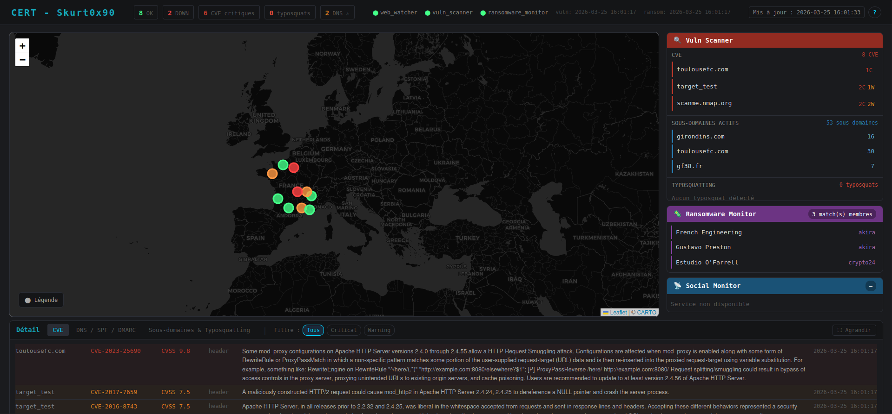
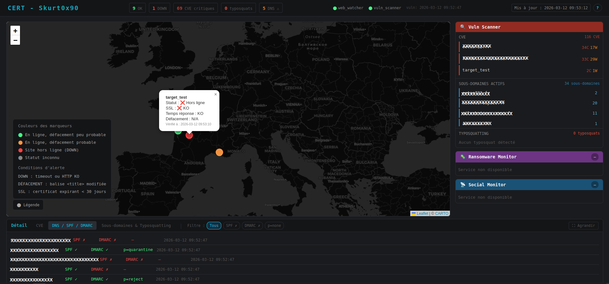
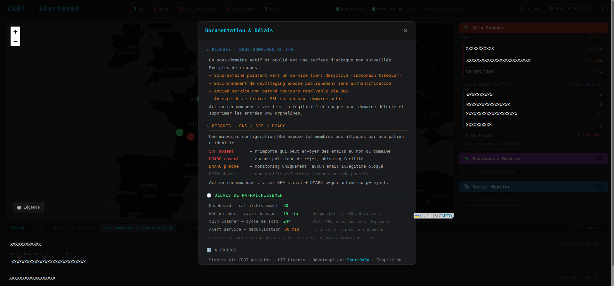

# 🛡️ "Starter Kit CERT" — THREAT-RADAR

Ce projet est une implémentation personnelle inspirée de l'article **"Déploiement opérationnel d'un starter kit du CERT"** publié dans [MISC n°142](https://connect.ed-diamond.com/misc/misc-142/deploiement-operationnel-d-un-starter-kit-du-cert-retour-d-experience-et-outils-open-source-pour-la-surveillance-proactive).

[](https://python.org)
[](https://docker.com)
[](LICENSE)
[]()
[]()
[](https://github.com/Skurt0x90)

---

## Architecture

Chaque service est un conteneur Flask indépendant qui tourne par cycles (APScheduler), écrit un JSON dans `data/outputs/` et l'expose sur `/api/data`. Les alertes passent par un service dédié (déduplication, email, Signal). Le dashboard agrège le tout.

| Service              | Rôle                                                                 |
|:---------------------|:---------------------------------------------------------------------|
| `web_watcher`        | Disponibilité, temps de réponse, SSL, défacement                     |
| `vuln_scanner`       | Surface d'attaque : stack, CVE, sous-domaines, SPF/DMARC, typosquats |
| `ransomware_monitor` | Revendications ransomware visant les membres                         |
| `social_monitor`     | Veille OSINT : flux RSS CTI et canaux Telegram publics               |
| `alert_service`      | Déduplication, historique, envoi email et Signal                     |
| `signal_cli`         | Passerelle REST vers Signal                                          |
| `dashboard`          | Interface Dash : carte, compteurs, panels, popups détaillés          |

---

## Pré-requis

- [Docker](https://docs.docker.com/get-docker/) installé sur votre machine.
- [Docker Compose](https://docs.docker.com/compose/install/) installé (généralement inclus avec Docker Desktop).

---

## Lancement

```bash
cp .env.example .env
cp ./data/inputs/keywords.example.txt ./data/inputs/keywords.txt
cp ./data/inputs/members.example.txt ./data/inputs/members.txt
cp ./data/inputs/targets.example.txt ./data/inputs/targets.txt
sudo docker compose --profile test up --build
```

| Service                 | URL                              | Attendu          |
|:------------------------|:---------------------------------|:-----------------|
| signal_cli              | http://localhost:8080/v1/about   | JSON version     |
| alert_service           | http://localhost:5005/health     | {"status":"ok"}  |
| web_watcher             | http://localhost:5001/health     | {"status":"ok"}  |
| web_watcher data        | http://localhost:5001/api/data   | JSON des sites   |
| vuln_scanner            | http://localhost:5002/health     | {"status":"ok"}  |
| vuln_scanner data       | http://localhost:5002/api/data   | JSON des CVE     |
| ransomware_monitor      | http://localhost:5003/health     | {"status":"ok"}  |
| ransomware_monitor data | http://localhost:5003/api/data   | JSON ransomware  |
| social_monitor          | http://localhost:5004/health     | {"status":"ok"}  |
| social_monitor data     | http://localhost:5004/api/data   | JSON social      |
| dashboard               | http://localhost:8050            | Interface Dash   |
| DVWA                    | http://localhost:8888            | Interface DVWA   |

---

## Configuration

Copiez `.env.example` en `.env` et renseignez vos valeurs (SMTP, Signal...).

### Cibles (`data/inputs/targets.txt`)

```
# domaine,longitude,latitude,titre attendu[,scan_mode]
exemple.fr,2.3522,48.8566,Accueil - Exemple
monmembre.fr,4.8357,45.7640,Mon Membre, site officiel,active
```

- **Titre attendu** : contenu normal de la balise `<title>` de la page. Le web_watcher s'en sert comme indice de défacement. Il peut contenir des virgules.
- **`scan_mode`** (dernière colonne, optionnel) :
  - `passive` (défaut) : surveillance non intrusive, aucune autorisation requise.
  - `active` : ajoute un scan nmap, **nécessite une convention signée avec le membre**.

### Sources de veille

Les sources sont des fichiers plats dans `data/inputs/` (des exemples sont disponibles) :

| Fichier                 | Format      | Usage                                                              |
|:------------------------|:------------|:-------------------------------------------------------------------|
| `rss_feeds.txt`         | `name,url`  | Flux RSS CTI / institutionnels surveillés                          |
| `telegram_channels.txt` | handle      | Canaux Telegram publics surveillés                                 |
| `keywords.txt`          | mot-clé     | Termes de corrélation sectorielle (mots entiers, pluriel toléré)   |
| `members.txt`           | nom         | Membres et sous-traitants (social et ransomware)                   |

Tous ces fichiers acceptent les commentaires (`#`) et les lignes vides.

### Variables d'environnement

| Variable                   | Défaut | Service             | Rôle                                                          |
|:---------------------------|:-------|:--------------------|:--------------------------------------------------------------|
| `WEB_WATCHER_INTERVAL`     | 15     | web_watcher         | Minutes entre deux cycles                                     |
| `VULN_SCANNER_INTERVAL`    | 24     | vuln_scanner, ransomware | Heures entre deux cycles                                 |
| `SOCIAL_INTERVAL`          | 60     | social_monitor      | Minutes entre deux cycles                                     |
| `LOOKBACK_DAYS`            | 7      | social_monitor      | Ancienneté maximale des articles et messages                  |
| `NVD_API_KEY`              | —      | vuln_scanner        | Optionnelle (gratuite sur nvd.nist.gov). Sans elle : 6 s entre deux requêtes NVD |
| `CVSS_MIN`                 | 7.0    | vuln_scanner        | CVE ignorées en dessous de ce score                           |
| `CVSS_CRITICAL`            | 9.0    | vuln_scanner, dashboard | Score à partir duquel une CVE à version précise est CRITICAL |
| `FAILURES_BEFORE_ALERT`    | 2      | web_watcher         | Cycles consécutifs en anomalie avant alerte (1 = immédiat)    |
| `RESPONSE_WARN_SECONDS`    | 3      | web_watcher         | Au-delà : temps de réponse « long »                           |
| `RESPONSE_KO_SECONDS`      | 8      | web_watcher         | Au-delà : temps de réponse « très long »                      |
| `SSL_EXPIRY_WARNING_DAYS`  | 30     | web_watcher         | Alerte quand le certificat expire avant ce délai              |
| `SSL_CACHE_HOURS`          | 6      | web_watcher         | Fréquence de revérification du certificat                     |
| `HTTP_RETRIES`             | 2      | web_watcher         | Tentatives HTTP par site et par cycle                         |
| `WATCHER_MAX_WORKERS`      | 10     | web_watcher         | Sites vérifiés en parallèle                                   |
| `DEDUP_WINDOW_MINUTES`     | 30     | alert_service       | Fenêtre anti-doublon des alertes                              |
| `SMTP_HOST`, `SMTP_PORT`, `SMTP_USER`, `SMTP_PASSWORD`, `ALERT_EMAIL_FROM`, `ALERT_EMAIL_TO` | — | alert_service | Envoi des emails |
| `SIGNAL_CLI_NUMBER`, `SIGNAL_CLI_GROUP_ID` | — | alert_service | Envoi Signal                                           |
| `CARTO_API_KEY`            | —      | dashboard           | Clé des tuiles de la carte                                    |

> Le `web_watcher` doit avoir `env_file: - .env` dans le `docker-compose.yml` pour lire ses variables depuis le `.env`.

---

## Fonctionnalités

- **Web Watcher** — disponibilité, temps de réponse, SSL, détection de défacement ✅
  - Une seule requête HTTPS par site et par cycle, sites vérifiés en parallèle
  - Alerte seulement après plusieurs cycles consécutifs en anomalie (SSL excepté)
  - Défacement : score de mots-clés sur le texte visible (scripts et CSS ignorés), titre modifié en indice secondaire
  - Certificat revérifié toutes les `SSL_CACHE_HOURS`
- **Vuln Scanner** — surveillance de la surface d'attaque ✅
  - Stack technique fusionnée depuis les headers HTTP, Shodan InternetDB et nmap (mode `active`) : une version retenue par produit, la plus récente, et à égalité la source la plus fiable (nmap > headers > InternetDB)
  - CVE recherchées sur NVD par CPE (version exacte, ou plage si la version est partielle), uniquement CVSS ≥ `CVSS_MIN`
  - Les CVE brutes d'InternetDB sont ignorées quand une source directe a une version plus récente (données périmées)
  - Énumération de sous-domaines via crt.sh (retries + fallback Certspotter)
  - Vérification SPF / DMARC
  - Détection de typosquatting via dnstwist
- **Ransomware Monitor** — veille sur les sites de leak ransomware (clear web : Ransomlive, Ransomlook, Ransomfeed) ✅
  - Un membre est détecté quand son nom normalisé (sans accents, ponctuation ni casse) est celui d'une victime des 2 derniers jours
- **Social Monitor** — veille OSINT via flux RSS CTI/institutionnels et scraping Telegram public ✅
  - Corrélation par mots entiers (« iga » ne matche plus « investigation »), CRITICAL si un membre est cité, WARNING pour un simple mot-clé
- **Alerting** — historique (200 dernières alertes), déduplication, email HTML par cycle ✅ / Signal ⚠️ *(enregistrement du numéro à effectuer manuellement, voir ci-dessous)*
- **Dashboard** — carte Leaflet dark, compteurs globaux, panels par service ✅
  - Bouton ⛶ : popup agrandi avec onglets, filtres et recherche
  - Détail CVE : tableau avec une colonne par champ et un filtre par colonne (domaine, CVE, CVSS minimum, niveau, précision, composant, description)

### Niveaux d'alerte (Vuln Scanner)

| Cas | Niveau |
|:---|:---|
| CVSS ≥ 9 (`CVSS_CRITICAL`) sur une version précise | CRITICAL |
| CVSS ≥ 9 mais version partielle ou recherche par mot-clé | WARNING |
| 7 ≤ CVSS < 9 | WARNING |
| CVSS < 7 (`CVSS_MIN`) | ignorée |
| CVE signalée par InternetDB mais non confirmée par NVD | WARNING |
| Version masquée ou partielle | WARNING |
| Port sensible exposé (mode `active`) | CRITICAL |
| Typosquat enregistré | CRITICAL |
| SPF / DMARC absent, DMARC `p=none`, sous-domaines actifs | WARNING |

### Niveaux d'alerte (Web Watcher)

| Cas | Niveau |
|:---|:---|
| Site DOWN (HTTP ≥ 400 hors 401/403/429, ou injoignable) | CRITICAL |
| Défacement fortement probable | CRITICAL |
| Défacement probable | WARNING |
| Temps de réponse long ou très long | WARNING |
| Certificat expirant bientôt ou invalide | WARNING |

Sauf le SSL, ces alertes demandent `FAILURES_BEFORE_ALERT` cycles consécutifs en anomalie.

### Niveaux d'alerte (Ransomware et Social)

| Cas | Niveau |
|:---|:---|
| Membre revendiqué par un groupe ransomware | CRITICAL |
| Membre cité dans un article ou un message | CRITICAL |
| Mot-clé sectoriel seul | WARNING |

### Ce qui n'est pas implémenté (hors scope de ce POC)

| Fonctionnalité | Raison |
|:---|:---|
| Ransomware Monitor — dark web (.onion) | Nécessite un proxy Tor dédié ; les sources clear web couvrent l'essentiel des revendications publiques |
| Social Monitor — Twitter/X | API devenue payante et très restrictive |
| Social Monitor — HaveIBeenPwned | Nécessite une vérification de propriété de domaine par email |
| Web Watcher — référence de contenu (hash, taille) | Détecterait les défacements sans mot-clé |

### Sources externes et limites

Le mode `passive` interroge des services tiers. Les adresses IP et domaines des membres surveillés leur sont transmis :

- **Shodan InternetDB** : usage non commercial, données mises à jour chaque semaine, uniquement pour les IP déjà scannées par Shodan. Derrière un CDN ou un hébergement mutualisé, les résultats décrivent l'IP et pas forcément le site.
- **crt.sh / Certspotter** : disponibilité variable, d'où les retries et le fallback.
- **NVD** : quotas plus larges avec une clé API.

Limites des résultats :

- Les CVE sont déduites des versions détectées, donc des faux positifs sont possibles.
- Quand seule une version partielle est exposée (ex : `PHP/8.5`), la CVE trouvée peut ne concerner que certaines 8.5.x, ce qui est signalé dans l'alerte.
- Le web_watcher ne teste que `https://domaine` : un site qui ne répond qu'en HTTP est vu comme DOWN.
- Les pages qui bloquent les robots (WAF, challenge anti-bot) peuvent fausser le défacement et le temps de réponse. Les codes 401, 403 et 429 ne sont pas comptés DOWN.
- Un titre de page qui change souvent (actualités, saisons) ne doit pas être utilisé comme titre attendu.

---

## Enregistrement Signal *(optionnel)*

L'alerting Signal est fonctionnel mais nécessite un enregistrement manuel unique :

```bash
# 1. Enregistrer le numéro
docker exec signal_cli signal-cli -u +336XXXXXXXX register

# 2. Vérifier avec le code SMS reçu
docker exec signal_cli signal-cli -u +336XXXXXXXX verify CODE

# 3. Récupérer l'ID du groupe (créer le groupe sur le téléphone avant)
docker exec signal_cli signal-cli -u +336XXXXXXXX listGroups

# 4. Ajouter dans .env
SIGNAL_CLI_GROUP_ID=group.XXXXXXXXXXXXXXXX==
```

> ⚠️ L'enregistrement est rate-limited — réessayer après quelques minutes en cas de 429.

---

## Tests

### Tests unitaires

Les tests utilisent `unittest` et des mocks : aucun accès réseau, aucune dépendance à nmap.

```bash
# services (depuis services/)
cd services
pip install -r web_watcher/requirements.txt -r vuln_scanner/requirements.txt \
            -r social_monitor/requirements.txt -r ransomware_monitor/requirements.txt \
            -r alert_service/requirements.txt coverage
coverage run -m unittest discover -v
coverage report
```

| Service              | Couvert                                                                          |
|:---------------------|:---------------------------------------------------------------------------------|
| `web_watcher`        | parsing des cibles, requête unique, SSL et cache, scoring de défacement, alertes, cycle, API |
| `vuln_scanner`       | fusion de la stack, versions/CPE, requêtes NVD, niveaux d'alerte, SPF/DMARC, sous-domaines, dnstwist, cycle |
| `social_monitor`     | corrélation par mots entiers, collecteurs RSS/Telegram, alertes, cycle           |
| `ransomware_monitor` | normalisation des noms, sources, corrélation, alertes, cycle                     |
| `alert_service`      | déduplication, email, Signal, historique, API                                    |
| `dashboard`          | fonctions de rendu et de filtrage, unicité des identifiants du layout            |

### Cibles de test

- **vuln_scanner** : DVWA (profil `test`, mode `passive` et `active`), `scanme.nmap.org` (mode `active`) et `testphp.vulnweb.com`.
- **web_watcher** :

| Cible | Résultat attendu |
|:---|:---|
| `example.com` | OK |
| `site-inexistant.invalid` | DOWN |
| `expired.badssl.com`, `self-signed.badssl.com`, `wrong.host.badssl.com` | DOWN + alerte SSL |
| `haveibeenpwned.com` | défacement probable (le mot « pwned ») |

Pour déclencher les alertes de lenteur et de SSL, abaissez les seuils : `FAILURES_BEFORE_ALERT=1`, `RESPONSE_WARN_SECONDS=0.05`, `RESPONSE_KO_SECONDS=0.3`, `SSL_EXPIRY_WARNING_DAYS=365`. Retirez-les ensuite, et videz `alert_dedup.json` si le dédoublonnage masque vos essais.

---

## Screenshot





---

## Stack

- Python 3.12 / Flask / APScheduler
- Docker / Docker Compose
- Dash / dash-leaflet / dash-mantine-components
- unittest + coverage, GitHub Actions + Codecov

---

## Licence

MIT